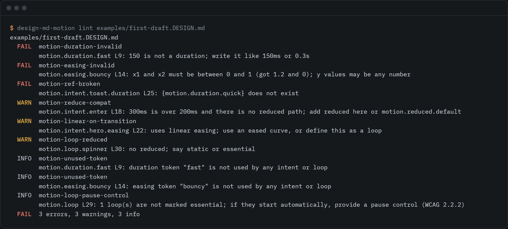

# design-md-motion

A motion section for DESIGN.md with lint rules and a reference example, plus print and video surface profiles.



```sh
npx github:rishsadh/design-md-motion lint DESIGN.md
```

It reads the front matter of a DESIGN.md file, checks the `motion:` block and any `surfaces:` block,
and tells you what is wrong and on which line. It also exports the motion tokens to CSS custom
properties or W3C design tokens JSON, and turns a spring into a CSS `linear()` easing.

## Why this exists

DESIGN.md, the format from google-labs-code/design.md for describing a visual identity to coding
agents, has no place for motion. An agent building from one invents its own durations and easings.

As of 30 September 2026, issue 47 on that repo asks for motion tokens. It has been open since 24 April
2026. The maintainer replied on 1 May that motion can be added as custom tokens in a custom section, and
asked people who do it to share what they made. A pull request that added motion to the base spec was
closed on 15 June on the grounds that the spec stays small and prose carries intent. So this is an
extension, not a change to the spec. It asks the base spec for nothing.

The issue thread also shows what a motion section has to handle that a scale of three durations does
not: loops are not transitions, reduced motion is usually a different behaviour and not a shorter
animation, and springs have no standard form. [SPEC.md](SPEC.md) is written around those points. The
print and video profiles come from the same idea: one DESIGN.md, more than one surface.

## Use it

```sh
# check a file (exit code 1 on errors, 2 on a usage problem)
npx github:rishsadh/design-md-motion lint DESIGN.md
npx github:rishsadh/design-md-motion lint DESIGN.md --strict --format json

# export
npx github:rishsadh/design-md-motion export DESIGN.md --format css
npx github:rishsadh/design-md-motion export DESIGN.md --format dtcg

# work out what a spring does, and get its CSS linear() easing
npx github:rishsadh/design-md-motion spring --stiffness 260 --damping 26

# print a starter block to paste into your DESIGN.md
npx github:rishsadh/design-md-motion init --surfaces

# list the rules, or explain one
npx github:rishsadh/design-md-motion rules
npx github:rishsadh/design-md-motion explain motion-reduce-compat
```

Options for `lint`: `--threshold <ms>` (default 200) sets where the reduced-motion check starts,
`--max-transition <ms>` (default 1000), `--max-settle <ms>` (default 1000), `--disable <rule,rule>`,
and `--strict` to fail on warnings. Use `-` as the file to read standard input.

### What goes in the file

A small motion block. Intents reference the scale, and every intent says what happens under reduced motion.

```yaml
motion:
  duration: { fast: 120ms, medium: 200ms, slow: 400ms }
  easing:
    standard: [0.2, 0, 0, 1]
    decelerate: [0, 0, 0, 1]
  spring:
    settle: { stiffness: 260, damping: 26 }
  loop:
    spinner: { period: 1100ms, easing: linear, reduced: essential }
  reduced: { default: fade, duration: 100ms }
  intent:
    enter:
      duration: "{motion.duration.medium}"
      easing: "{motion.easing.decelerate}"
      properties: opacity 0 to 1, rise 8px
      reduced: fade
    confirm:
      spring: "{motion.spring.settle}"
      properties: scale 0.9 to 1 with a small overshoot
      reduced: ease
```

Then a `## Motion` section in the body, between Shapes and Components, for what a scale cannot hold:
when to move, what leads, what the choreography is, and what reduced motion looks like.

Print and video profiles are a `surfaces:` block:

```yaml
surfaces:
  print: { trim: { width: 210mm, height: 297mm }, bleed: 3mm, safe-margin: 6mm, color-mode: cmyk, color-profile: your printer's profile }
  video: { width: 1920, height: 1080, frame-rate: 25, safe-area: { action: 3.5%, graphics: 5% } }
```

### Examples

| File | What it shows |
|---|---|
| [examples/daylight-prestige.DESIGN.md](examples/daylight-prestige.DESIGN.md) | A complete reference: a DESIGN.md with a full motion block and section. No errors, no warnings |
| [examples/studio-print-video.DESIGN.md](examples/studio-print-video.DESIGN.md) | One file carrying web, print and video surfaces. Clean |
| [examples/issue-47-as-proposed.DESIGN.md](examples/issue-47-as-proposed.DESIGN.md) | The block from issue 47, unchanged, read as written |
| [examples/first-draft.DESIGN.md](examples/first-draft.DESIGN.md) | The mistakes people usually make. This is the file in the image above |
| [examples/bad/](examples/bad) | One file per group of rules, used by the tests |

### The rules

There are 36 rules, in [docs/RULES.md](docs/RULES.md), each with its reason. The ones that matter most:

- `motion-reduce-compat`: a transition over 200ms with no reduced-motion path.
- `motion-loop-reduced`: a loop with no say on what happens when motion is reduced.
- `motion-linear-on-transition`: linear easing on a one-way transition.
- `motion-ref-broken`: an intent that points at a token that is not there.
- `print-bleed-missing`: a print size with no bleed.
- `video-safe-area`: graphics that are not inside the action-safe area.
- `video-duration-off-grid`: a motion duration that does not land on whole video frames.

Warnings are questions. To keep one on purpose, list it under `motion.acknowledged` with a reason.

## What it does not do

- **It does not change DESIGN.md.** The official linter reads these files with no errors, and warns
  that `motion` and `surfaces` are ignored by its exporters ([docs/UPSTREAM.md](docs/UPSTREAM.md)). Use
  the exporters here for those.
- **It checks the file, not your product.** It cannot tell if a page respects `prefers-reduced-motion`,
  if a video flashes, or if a PDF has the bleed it says it has. It checks that the numbers you
  declared are consistent and within limits.
- **Some thresholds are judgement calls.** The 200ms reduced-motion line and the 1000ms ceilings are
  heuristics, not WCAG numbers. WCAG 2.3.3 has no duration threshold. Both are configurable.
- **Print numbers are yours.** Minimum text size, stroke and image resolution depend on your printer,
  so there are no defaults. Bleed, safe-area and flash limits are cited in
  [docs/SOURCES.md](docs/SOURCES.md).
- **Springs are checked as physics.** Damping ratio, overshoot and settle time come from the closed
  form solution, not from a browser. The CSS export samples the curve, so it is an approximation.
- **The video profile overlaps HyperFrames `frame.md` in places.** That format describes how to compose
  a video. This one is a short block of limits inside a DESIGN.md.
- **No platform overlay zones** for short vertical video. They change too often to ship as facts.
- **It is a draft.** Version 0.1, the spec will change.

Needs Node 18 or later. One dependency, `yaml`.

## Licence

MIT. By [@rishsadh](https://github.com/rishsadh).
